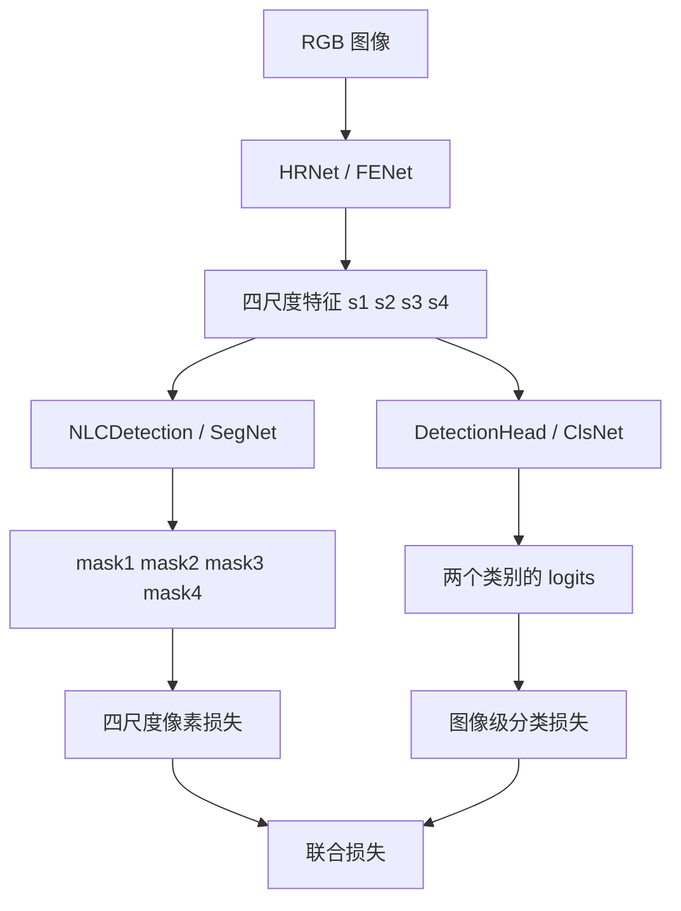
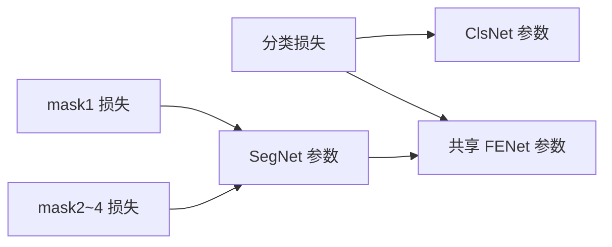

# PSCC-Net 复现与代码学习指南

> 面向目标：在 RTX 4090 24GB 上复现项目，并能从论文公式一路解释到 PyTorch 中的张量操作。
>
> 编写日期：2026-11-06。依据本地论文、README 和当前工作区代码；编写时 Git HEAD 为 `99de11c`，工作区还包含兼容性工具文件。
>
> 本文没有执行训练、推理或测试。文中的形状、计算量与训练步数来自代码推导；论文结果均明确标注为论文报告值，不代表当前环境已经复现。

## 阅读导航

1. [如何使用这份文档](#reading-map)
2. [任务、论文动机与整体设计](#overview)
3. [项目目录与源码阅读顺序](#source-map)
4. [统一符号与全模型形状表](#shapes)
5. [HRNet：多尺度特征如何产生和融合](#hrnet)
6. [渐进定位：为什么从 Mask 4 走到 Mask 1](#progressive)
7. [SCCM：逐步拆解空间与通道相关性](#sccm)
8. [分类头：图片级真假如何判断](#classification)
9. [数据合成、划分、采样与预处理](#data)
10. [损失函数：公式、权重和梯度](#loss)
11. [训练策略与一次迭代的完整过程](#training)
12. [初始化、检查点与恢复训练](#checkpoint)
13. [验证、推理与论文评估协议](#evaluation)
14. [论文与当前代码的差异清单](#differences)
15. [在 4090 上复现的操作路线](#reproduction)
16. [逐文件精读路线与思考题](#study)
17. [常见问题与排查方向](#faq)
18. [公式速查、术语与资料来源](#references)

<a id="reading-map"></a>

## 1. 如何使用这份文档

建议分三遍学习。

**第一遍看数据流。** 阅读第 2～4 节，回答“输入是什么、三个网络分别输出什么、最终结果是什么”。先不要纠结每个卷积层。

**第二遍看模型与优化。** 阅读第 5～11 节，拿着 `256×256` 的例子逐行对照代码。重点掌握 HRNet 融合、SCCM 矩阵维度、多尺度监督，以及两种任务的梯度如何汇入共享主干。

**第三遍准备复现。** 阅读第 12～17 节，先确定你要做“已有权重推理”“从 ImageNet 主干初始化重新训练”，还是“在目标数据集微调”。这三件事的初始化、数据划分和评价对象不同。

全文使用三种表述来区分依据：

| 标记 | 含义 |
|---|---|
| **论文** | 本地论文明确给出的结构、公式或实验条件 |
| **代码** | 当前工作区实际执行的逻辑 |
| **复现建议** | 为了控制实验变量给出的做法，不表示仓库已实现 |

论文见 [本地 PDF](<../docs/Liu 等 - 2022 - PSCC-Net Progressive Spatio-Channel Correlation Network for Image Manipulation Detection and Locali.pdf>)。当前文件在 `doc/`，论文在 `docs/`，两个目录名称不同。

<a id="overview"></a>

## 2. 任务、论文动机与整体设计

### 2.1 两个任务，四种数据类别

PSCC-Net 的全称是 **Progressive Spatio-Channel Correlation Network**，研究图像篡改检测与定位，简称 IMDL。

给定图片 `I`，模型完成：

- **Detection，图像级检测**：判断整张图是否存在篡改。
- **Localization，像素级定位**：判断哪些像素属于篡改区域。

训练数据按来源分为四类：真实、拼接、复制移动、修补移除。数据加载器暂时用 `0/1/2/3` 标记这四类，但训练入口马上执行：

```python
cls[cls != 0] = 1
```

因此最终分类问题只有 `authentic=0` 与 `forged=1`。当前模型没有“拼接/复制移动/修补”三种篡改类型的分类输出。

### 2.2 为什么需要这个结构

论文第 1～3 页讨论了三个难点：

1. **篡改尺度差异大。** 被替换的可能是很小的局部，也可能是大半张图片，需要同时利用局部细节与全局关系。
2. **判断依赖区域之间的关系。** 仅看一个局部，可能无法知道它是否来自别处；比较图内区域或特征通道之间的相关性有助于寻找不一致。
3. **真实图也必须参与训练。** 只在篡改图上学习定位，容易把正常纹理也当成篡改证据。需要显式的图像级真假判断。

对应解决思路是：

| 难点 | 设计 |
|---|---|
| 尺度变化 | HRNet 同时维护并融合多个分辨率的特征 |
| 区域与通道之间的关系 | SCCM 同时计算空间相关性与通道相关性 |
| 定位困难 | 从粗掩码出发，逐级引导更精细的定位 |
| 真实图误报 | 使用真实图训练，并增加独立的检测头 |

“特征相关性”不是人工规定相机指纹，也不是显式做图像检索；这些用于判断篡改的表征由联合训练学习。

### 2.3 三个网络的关系



必须记住：**两个头共享 HRNet 特征，但分类头并不读取定位头输出的掩码。**

当前 `test.py` 在一次循环内先计算定位、再计算分类。论文讨论了“先检测，只有检测为假才定位”和“在粗尺度提前退出”的加速可能性，但当前入口没有实现这些分支。


<a id="source-map"></a>

## 3. 项目目录与源码阅读顺序

```text
PSCC-Net/
├── train.py                     联合训练、验证、模型保存
├── test.py                      sample 目录上的推理演示
├── models/
│   ├── seg_hrnet.py              HRNet 主干
│   ├── seg_hrnet_config.py       主干各阶段通道与模块配置
│   ├── NLCDetection.py           NonLocalMask + 渐进定位
│   ├── detection_head.py         多尺度特征融合与真假分类
│   └── hrnet_w18_small_v2.pth    主干初始化权重
├── utils/
│   ├── config.py                 训练和路径配置
│   ├── load_tdata.py             TrainData、ValData、增强、多尺度标签
│   ├── load_vdata.py             TestData
│   ├── image_io.py               RGB/掩码读取与掩码路径映射
│   ├── checkpoint.py             权重兼容与完整恢复检查
│   ├── paths.py                  项目根路径与跨平台文件名
│   └── utils.py                  调整学习率、保存预测图等
├── dataset/                     训练数据、说明和测试名单
├── dataset_generation/          数据准备/生成脚本
├── checkpoint/                  三个网络的权重与训练检查点
├── sample/                      推理演示图片
├── mask_results/                save_tag=True 时的定位结果
├── docs/                        本地论文等资料
└── doc/                         本学习文档
```

推荐阅读顺序：

```text
utils/config.py
  → train.py 的 train() 主流程
  → utils/load_tdata.py
  → models/seg_hrnet_config.py
  → models/seg_hrnet.py 的 forward()
  → models/NLCDetection.py
  → models/detection_head.py
  → train.py 的损失与 validation()
  → utils/checkpoint.py
  → test.py
```

一开始可以只读每个类的 `__init__()` 与 `forward()`，等数据流清楚后，再回头读 `_make_layer()` 等组装函数。

<a id="shapes"></a>

## 4. 统一符号与全模型形状表

### 4.1 NCHW 与论文记号

论文通常把特征写成 `H×W×C`；代码使用 PyTorch 的 `B×C×H×W`：

| 符号 | 含义 |
|---|---|
| `B` | batch size |
| `C` | 特征通道数，不是分类类别数 |
| `H, W` | 当前特征的高与宽 |
| `s=2` | 主干相邻特征尺度之间的下采样比例 |
| `r` | SCCM 内部 reshape 使用的缩放参数，与主干的 `s` 不同 |
| `D=C*r*r` | SCCM 重排后的通道数，对应代码 `self.ic` |
| `N=H*W/(r*r)` | SCCM 重排后的空间位置数 |

### 4.2 默认 256×256 输入

下表的形状由配置和卷积步长推导，省略 BN/ReLU 这类不改变形状的操作：

| 位置 | 输出形状 |
|---|---|
| 输入 | `[B,3,256,256]` |
| 主干两层 stem 卷积之后 | `[B,64,256,256]` |
| 主干 Stage 1 之后 | `[B,256,256,256]` |
| HRNet 最终 `s1` | `[B,18,256,256]` |
| HRNet 最终 `s2` | `[B,36,128,128]` |
| HRNet 最终 `s3` | `[B,72,64,64]` |
| HRNet 最终 `s4` | `[B,144,32,32]` |
| 定位输出 `mask1` | `[B,1,256,256]` |
| 定位输出 `mask2` | `[B,1,128,128]` |
| 定位输出 `mask3` | `[B,1,64,64]` |
| 定位输出 `mask4` | `[B,1,32,32]` |
| 分类输出 `pred_logit` | `[B,2]` |

**注意 Stage 1 的256通道与最终 `s1` 的18通道不是同一件事。** 最终四尺度特征是在多次 transition 与融合之后得到的。

输入尺寸不是256时，主干先处理原图，两个头再将四尺度特征插值到 `crop_size` 指定的固定大小。它没有在进入 HRNet 前统一把所有原图缩到256。

<a id="hrnet"></a>

## 5. HRNet：多尺度特征如何产生和融合

源码：[seg_hrnet.py](../models/seg_hrnet.py)、[seg_hrnet_config.py](../models/seg_hrnet_config.py)。论文对应第 3 页 III-A。

### 5.1 这里的 HRNet 与常见分类主干有何不同

普通分类网络通常一路降低分辨率，最后只留下一个低分辨率特征。这里的主干持续保留高分辨率分支，并逐步加入低分辨率分支，各分支反复交换信息。

当前 stem 的两层 `3×3` 卷积都是 `stride=1, padding=1`，因此不会把输入先降到四分之一。不要按其他 HRNet 仓库中的默认步长推测本项目形状。

```python
self.conv1 = nn.Conv2d(3, 64, kernel_size=3, stride=1, padding=1, bias=False)
self.conv2 = nn.Conv2d(64, 64, kernel_size=3, stride=1, padding=1, bias=False)
```

### 5.2 四个阶段

| 阶段 | 并行分支数 | 分支通道配置 | 每分支 block 数 | block 类型 |
|---|---:|---|---|---|
| Stage 1 | 1 | `[64]`，经过 expansion 后为256 | `[2]` | Bottleneck，expansion=4 |
| Stage 2 | 2 | `[18,36]` | `[2,2]` | BasicBlock，expansion=1 |
| Stage 3 | 3 | `[18,36,72]` | `[2,2,2]` | BasicBlock |
| Stage 4 | 4 | `[18,36,72,144]` | `[2,2,2,2]` | BasicBlock |

每个 Stage 2～4 的 `NUM_MODULES=1`。一个 `HighResolutionModule` 内先更新各分支，再完成跨分支融合。

`transition` 的作用是让上一个阶段的输出适应下一个阶段：已有分支若通道一致可直接传递，新出现的低分辨率分支由之前最低分辨率特征通过步长为2的卷积生成。

### 5.3 BasicBlock 与 Bottleneck

`BasicBlock` 的主分支为：

```text
3×3 Conv → BN → ReLU → 3×3 Conv → BN
```

与输入的残差支路相加后，再经过 ReLU。

主干 `Bottleneck` 的主分支为：

```text
1×1 Conv → BN → ReLU
3×3 Conv → BN → ReLU
1×1 Conv → BN
```

最后一层输出 `planes*4` 通道。若输入与输出形状不同，残差支路也用 `1×1` 卷积对齐。

分类头里也有一个名为 `Bottleneck` 的类，但其 `expansion=2`。**两个同名类的通道扩张系数不同，阅读时不要混用。**

### 5.4 多尺度融合如何对齐

在 `HighResolutionModule.forward()` 中，对目标分支 `i`，来自源分支 `j` 的特征有三种处理：

| 关系 | 操作 |
|---|---|
| `j == i` | 同尺度，直接参与相加 |
| `j > i`，源特征分辨率更低 | `1×1 Conv + BN` 对齐通道，再双线性插值到目标大小 |
| `j < i`，源特征分辨率更高 | 一层或多层 `3×3, stride=2` 卷积降低分辨率并对齐通道 |

各路结果是**相加**，不是拼接。可以抽象为：

$$
F_i^{out}=\operatorname{ReLU}\left(\sum_j T_{j\to i}(F_j)\right).
$$

相加要求最终的通道、高、宽全部一致。这样 `s1` 虽保持高分辨率，也能得到低分辨率分支提供的较大范围信息。

### 5.5 主干返回什么

`HighResolutionNet.forward()` 最后返回四个特征组成的列表，没有在这里返回分割结果，也没有接 ImageNet 的分类器：

```python
feat = FENet(image)
s1, s2, s3, s4 = feat
```

不要把主干内部不同阶段的临时列表，和最终输出给两个头的四尺度列表混为一谈。

<a id="progressive"></a>

## 6. 渐进定位：为什么从 Mask 4 走到 Mask 1

源码：[NLCDetection.py](../models/NLCDetection.py) 中的 `NLCDetection`；论文第 4 页公式(1)。

### 6.1 计算顺序与返回顺序相反

计算时先处理最低分辨率的 `s4`，逐级走到 `s1`：

```text
s4 ──────────────→ SCCM4 → mask4
                                ↓ 上采样
s3 × up(mask4) ──→ SCCM3 → mask3
                                ↓ 上采样
s2 × up(mask3) ──→ SCCM2 → mask2
                                ↓ 上采样
s1 × up(mask2) ──→ SCCM1 → mask1
```

但是函数返回：

```python
return mask1, mask2, mask3, mask4
```

所以 `SegNet(feat)[0]` 取到的是最终最高分辨率掩码，而不是最先计算出来的粗掩码。

### 6.2 将论文公式展开

设第 `i` 级定位模块为 `f_i`，上采样为 `U`，逐元素相乘为 `⊙`：

$$
M_4=f_4(F_4),\qquad
M_i=f_i\big(F_i\odot U(M_{i+1})\big),\quad i=3,2,1.
$$

代码中的核心是：

```python
mask4, z4 = self.getmask4(s4)
mask4U = F.interpolate(mask4, size=s3.size()[2:], mode='bilinear', align_corners=True)
s3 = s3 * mask4U
mask3, z3 = self.getmask3(s3)
```

`mask4U` 的通道数为1，而 `s3` 的通道数为72；广播使同一空间位置的全部72个通道都乘上同一个掩码值。

例如一个位置的 `mask4U=0.9`，该位置特征被保留较多；若为0.05，则该位置被显著抑制。这是连续的软引导，不是在训练中先把掩码按0.5阈值切成0/1。

### 6.3 为什么中间尺度也需要监督

若只监督最终 `mask1`，中间掩码只需要有利于最后输出，不一定具有“篡改概率图”的可解释含义。四尺度监督要求每一级都接近对应大小的真实掩码，让中间结果承担明确任务。

“粗到细”是结构上的设计目标与论文中的整体实验现象，不保证任意一张图片都在每一级单调提升某个指标。

### 6.4 梯度能否经过上一级掩码

能。这里没有 `detach()`，也没有不可微的硬阈值。最终尺度的损失可以通过乘法与上采样继续影响前面的粗尺度定位模块。

这意味着 `getmask4` 不只受到 `mask4_loss` 的直接监督，还能间接受到后续细尺度损失的影响。四个 SCCM 是不同的模块实例，参数不是四尺度共享；共享的是每个 SCCM 内空间分支和通道分支所使用的嵌入。

`z1～z4` 是模块同时返回的增强特征，但 `NLCDetection.forward()` 中没有把它们传给下一级。下一级使用的是 **HRNet 原有尺度特征乘以上一级掩码**。

<a id="sccm"></a>

## 7. SCCM：逐步拆解空间与通道相关性

源码：[NLCDetection.py](../models/NLCDetection.py) 中的 `NonLocalMask`。论文对应第 4～5 页、图3、公式(2)～(4)。类名虽然叫 `NonLocalMask`，对应的核心思想就是论文 SCCM。

### 7.1 一次模块调用的输入与输出

```python
mask, z = self.getmask1(x)
```

| 张量 | 形状 | 含义 |
|---|---|---|
| `x` | `[B,C,H,W]` | 本尺度输入特征，可能已经乘过粗掩码 |
| `z` | `[B,C,H,W]` | 融合空间和通道相关性的增强特征 |
| `mask` | `[B,1,H,W]` | 经过 sigmoid 的篡改概率图 |

### 7.2 第一步：reshape 降低空间相关矩阵规模

```python
self.r = reduce_scale
self.ic = in_channels * self.r * self.r
self.mc = self.ic
x1 = x.reshape(b, self.ic, h // self.r, w // self.r)
```

定义：

$$
D=Cr^2,\qquad N=\frac{HW}{r^2}.
$$

重排后的元素总数没有改变：`C*H*W = D*N`。它没有像平均池化一样主动取均值，也没有通过插值丢掉元素。

但是，**当前实现是直接 `reshape`，不能直接解释成标准 `pixel_unshuffle`。** `pixel_unshuffle` 对邻近像素有特定的维度置换规则，单纯 reshape 只是按存储顺序重新解释数据。这一点在自行重写模型时非常重要。

四个尺度的默认参数：

| 模块 | `C` | `H×W` | `r` | `D=C*r²` | `N=HW/r²` | 空间矩阵 `A_s` | 通道矩阵 `A_c` |
|---|---:|---|---:|---:|---:|---|---|
| `getmask1` | 18 | 256×256 | 4 | 288 | 4096 | 4096×4096 | 288×288 |
| `getmask2` | 36 | 128×128 | 2 | 144 | 4096 | 4096×4096 | 144×144 |
| `getmask3` | 72 | 64×64 | 2 | 288 | 1024 | 1024×1024 | 288×288 |
| `getmask4` | 144 | 32×32 | 1 | 144 | 1024 | 1024×1024 | 144×144 |

以上矩阵还各自带有 batch 维度。

若直接在256×256空间上计算完整相关矩阵，需要 `65536×65536` 个元素；FP32 单张矩阵就是16GiB。`r=4` 后成为 `4096×4096`，单张矩阵为64MiB，元素数量降低256倍。

这里节省的是相关性计算规模，不能据此认为整个模块只需要64MiB：前向还会产生 softmax 输出、其他尺度特征；训练还要保留反向传播所需张量。

### 7.3 第二步：构造 g、theta、phi 三个嵌入

三个 `1×1` 卷积都是 `D→D`：

```python
g_x = self.g(x1).view(b, self.ic, -1).permute(0, 2, 1)
theta_x = self.theta(x1).view(b, self.mc, -1)
phi_x = self.phi(x1).view(b, self.mc, -1)
```

因此：

| 变量 | 形状 |
|---|---|
| `g_x` | `[B,N,D]` |
| `theta_x` | `[B,D,N]` |
| `phi_x` | `[B,D,N]` |

为了让公式直观，定义 `Q=theta_xᵀ`、`K=phi_xᵀ`、`V=g_x`，它们都是 `[B,N,D]`。

`theta` 与 `phi` 是两套独立卷积，不能假设 `Q=K`。本代码中也没有 Transformer 常见的 `1/sqrt(D)` 缩放、多头切分或位置编码。

### 7.4 第三步：空间相关性

```python
theta_x_s = theta_x.permute(0, 2, 1)  # [B,N,D]
phi_x_s = phi_x                       # [B,D,N]
f_s = torch.matmul(theta_x_s, phi_x_s) # [B,N,N]
f_s_div = F.softmax(f_s, dim=-1)
```

按统一记号：

$$
A_s=\operatorname{softmax}(QK^\top),\qquad Y'_s=A_sV.
$$

`A_s[i,j]` 表示重排后的第 `i` 个位置对第 `j` 个位置的相关性权重。softmax 沿最后一维进行，所以一行权重加起来为1。

对于某个查询位置，输出是所有位置特征的加权汇聚。它可以建立长距离联系，超出局部 `3×3` 卷积的直接邻域。

不要把“第i个位置”直接当成原始图像第i个像素：`r>1` 时已经发生 reshape，注意力定义在重排后的表示上。

空间分支回到原形状的代码为：

```python
y_s = torch.matmul(f_s_div, g_x)          # [B,N,D]
y_s = y_s.permute(0, 2, 1).contiguous()  # [B,D,N]
y_s = y_s.view(b, c, h, w)              # [B,C,H,W]
```

`permute()` 改变维度顺序；`contiguous()` 按新顺序生成连续存储；`view()` 再恢复四维。它们不是相互可替代的操作。

### 7.5 第四步：通道相关性

```python
theta_x_c = theta_x                       # [B,D,N]
phi_x_c = phi_x.permute(0, 2, 1)          # [B,N,D]
f_c = torch.matmul(theta_x_c, phi_x_c)     # [B,D,D]
f_c_div = F.softmax(f_c, dim=-1)
y_c = torch.matmul(g_x, f_c_div)          # [B,N,D]
y_c = y_c.view(b, c, h, w)
```

对应：

$$
A_c=\operatorname{softmax}(Q^\top K),\qquad Y'_c=VA_c.
$$

空间分支比较“位置与位置”，通道分支比较“特征维与特征维”。不同通道可能对同一类线索有响应，通道相关性用于重组这些响应。

它不是 SE 模块那种给每个通道乘一个标量的做法，而是产生一个 `D×D` 的矩阵，对通道表示进行混合。

**需要单独核对的实现细节：** 空间分支先 `permute` 再恢复四维；通道分支对 `[B,N,D]` 直接 `view(b,c,h,w)`，没有同样的转置。论文用 `h⁻¹` 描述两路恢复，而代码的两条恢复路径并不相同。仅凭尺寸匹配不能证明它们在逐元素排列上等价。复现当前官方实现时应保留原操作；若要改成自己理解的逆重排，应单独作为实现核对/消融实验，不能悄悄替换后仍宣称完全相同。

### 7.6 第五步：残差融合

```python
z = x + self.gamma_s * self.W_s(y_s) + self.gamma_c * self.W_c(y_c)
```

论文公式(4)：

$$
Z=X+\alpha_s\omega_s(Y_s)+\alpha_c\omega_c(Y_c).
$$

| 论文符号 | 代码 |
|---|---|
| `alpha_s, alpha_c` | `gamma_s, gamma_c` |
| `omega_s, omega_c` | `W_s, W_c`，两层各自独立的 `1×1` 卷积 |

两个 `gamma` 都是可训练标量，初值为1，没有强制约束它们非负，也不是概率。残差项保留输入信息，另外两路补充全局关联信息。

### 7.7 第六步：从增强特征产生单通道掩码

```text
Z: [B,C,H,W]
 → 3×3 Conv，C→16
 → ReLU
 → 3×3 Conv，16→1
 → Sigmoid
 → mask: [B,1,H,W]
```

`sigmoid` 把输出映射到0～1。代码中的 `z.clone()` 只复制张量，仍保留计算图；它没有像 `detach()` 一样切断梯度。

### 7.8 空间、通道和渐进机制各负责什么

| 机制 | 解决的问题 | 所在位置 |
|---|---|---|
| HRNet 多尺度融合 | 把不同尺度信息放进每级特征 | 主干 |
| 空间相关性 | 汇聚不同位置之间的关系 | 每个 SCCM 内部 |
| 通道相关性 | 汇聚特征通道之间的关系 | 每个 SCCM 内部 |
| 渐进掩码引导 | 用粗预测约束下一层细预测的关注区域 | SCCM 与 SCCM 之间 |

四者不是同一个“注意力”过程，学习时应分别理解。

<a id="classification"></a>

## 8. 分类头：图片级真假如何判断

源码：[detection_head.py](../models/detection_head.py)。

### 8.1 为什么不直接取掩码均值

掩码上的少量误报、篡改区域大小以及不同图片的背景比例，都会影响“把像素概率取平均当成图片分数”的策略。分类头直接学习四尺度特征到真假分数的映射。

论文第 7 页表IV比较了使用掩码平均分数的 `PSCC-Net†` 和显式检测头的完整模型，说明检测头是论文设计的一部分，不是可有可无的输出格式转换。

### 8.2 通道提升与逐级融合

先对四尺度特征分别使用 `expansion=2` 的 Bottleneck：

| 特征 | 输入 | Bottleneck 输出 |
|---|---|---|
| `s1` | `[B,18,256,256]` | `[B,36,256,256]` |
| `s2` | `[B,36,128,128]` | `[B,72,128,128]` |
| `s3` | `[B,72,64,64]` | `[B,144,64,64]` |
| `s4` | `[B,144,32,32]` | `[B,288,32,32]` |

融合从高分辨率向低分辨率进行：

```python
y = self.incre_modules[0](s1)
y = self.incre_modules[1](s2) + self.downsamp_modules[0](y)
y = self.incre_modules[2](s3) + self.downsamp_modules[1](y)
y = self.incre_modules[3](s4) + self.downsamp_modules[2](y)
```

下采样模块是 `3×3 stride=2 Conv + BN + ReLU`。每次相加后形状依次为 `[B,72,128,128]`、`[B,144,64,64]`、`[B,288,32,32]`。

最后通过 `1×1 Conv + BN + ReLU` 把288通道变为128，再全局平均池化：

```text
[B,128,32,32] → [B,128] → Linear(128,16) → ReLU → Linear(16,2)
```

### 8.3 Logits、概率与类别

分类头返回的是两个未归一化分数 `logits`，训练时直接交给 `CrossEntropyLoss`。

推理时：

```python
prob = torch.softmax(logits, dim=1)
fake_score = prob[:, 1]
label = logits.argmax(dim=1)
```

softmax 前后的 argmax 相同。第二列是篡改分数，后续计算图片级 ROC/AUC 应保留它，而不是只保存 `authentic/forged` 文本。

<a id="data"></a>

## 9. 数据合成、划分、采样与预处理

源码：[load_tdata.py](../utils/load_tdata.py)、[load_vdata.py](../utils/load_vdata.py)、[image_io.py](../utils/image_io.py)。论文对应第 5 页 III-D。

### 9.1 合成训练数据的组成

| 类别 | 论文/README 数量 | 来源与作用 |
|---|---:|---|
| 内容感知拼接 | 76,583 | COCO 标注区域贴到另一张图上，执行几何/亮度等变换 |
| 随机掩码拼接 | 40,000 | 使用随机轮廓，增加非完整物体形状的篡改区域 |
| 复制移动 | 100,000 | 基于 USCISI-CMFD 数据 |
| 修补移除 | 78,246 | 使用修补方法填充 COCO 中被移除的标注区域 |
| 真实图 | 81,910 | 从 COCO 选取 |

拼接两部分合计116,583张；全部数据共376,739张，论文约记为0.38M。数据总量、每轮采样量、验证集大小是三种不同的数量。

### 9.2 磁盘目录与清单格式

下面是与当前加载器相符的布局示例：

```text
dataset/
├── authentic/
│   ├── authentic.txt          每行相对于 authentic/ 的图片路径
│   └── images/000001.jpg
├── splice/
│   ├── fake.txt               例如 fake/000001.jpg
│   ├── fake/000001.jpg
│   └── mask/000001.png
├── splice_randmask/
│   ├── fake.txt
│   ├── fake/000001.tif
│   └── mask/000001.png
├── copymove/
│   ├── fake.txt               例如 fake/000001.png
│   ├── fake/000001.png
│   └── mask/000001.png
└── inpainting/
    ├── fake.txt               例如 fake/000001.jpg
    ├── fake/000001.jpg
    └── mask/000001.png
```

这些名称是布局示例，不代表数据已经下载。仓库中的目录和说明文件不能代替真实图片与清单。

`_read_names()` 会过滤空行，处理 UTF-8 BOM，并将清单里的反斜杠转为正斜杠。清单路径应相对所属类别目录编写，方便迁移到服务器。

`mask_path()` 把目录组件 `fake` 替换为 `mask`：拼接和修补的掩码扩展名改成 `.png`；复制移动保留原扩展名。它不会把上级目录或文件名中任意一个 `fake` 子串全部替换。

### 9.3 训练/验证划分

`authentic`、`splice`、`copymove`、`inpainting` 四个清单：

- 前 `val_num` 行进入验证集。
- 后续行进入训练候选池。
- `splice_randmask` 的全部清单进入拼接训练候选池，不额外划出这部分验证样本。

这是按清单顺序划分，不是每次启动随机划分。当前 `val_num=200`，数据充足时验证集共800张；论文写的是每类100张，共400张。

复现时不仅要记录 `val_num`，还要固定清单内容和顺序。如果同一源图衍生出多个篡改版本，仅按生成文件分开不一定能消除源图层面的泄漏，需要进一步核查数据来源。

### 9.4 每轮100,000次采样如何实现

`TrainData.__len__()` 返回 `train_num=100000`，不返回磁盘候选图片总数。

对每个索引，先根据索引所属区间决定四类之一，再在该类别的候选列表中随机抽取一张图片：

```text
索引 0～24999       → 真实图候选池
索引 25000～49999   → 拼接候选池
索引 50000～74999   → 复制移动候选池
索引 75000～99999   → 修补候选池
```

之后 `DataLoader(shuffle=True)` 打乱索引顺序。

因此默认每轮各类各采样25,000次，但同一张图片可以重复抽到；一次 batch 内也不保证四类严格均衡。`shuffle=True` 并没有把随机候选池采样变成不放回遍历。

拼接候选池中，内容感知和随机掩码两部分先拼成一个列表，再随机抽样，并没有固定“一半内容感知、一半随机掩码”。

四类均衡也不等于真假均衡：真实图占25%，另外三类合计75%为假图。这解释了分类损失为什么还要使用类别权重。

### 9.5 一张训练图片的完整处理链

```text
类别索引 → 类别候选池随机选图
 → 读取并转RGB
 → 真实图生成全零掩码；篡改图读取对应掩码
 → 检查原图与掩码尺寸
 → 将整图及掩码 resize 到 crop_size
 → 对图像和掩码应用同一个旋转/翻转
 → 图像 float32 /255，HWC→CHW
 → 掩码生成四尺度二值标签
```

`crop_size` 这个名字容易让人误会。当前代码执行的是整图 `resize`，没有随机截取一个256×256的局部 patch。非正方形原图被缩放为正方形时，长宽比也会变化。

### 9.6 颜色、数值范围与透明度

当前 `read_rgb_image()` 用 Pillow 读取，输出RGB三通道。灰度图会转换为RGB；透明图以白色背景合成后再转RGB。

图像最终是 `float32`、范围约为 `[0,1]`，没有做 ImageNet mean/std 标准化。即使主干使用 ImageNet 权重，也不要未经对照就额外加入标准化，那会改变输入分布。

当前 `read_mask()` 接受0/1或0～255编码的单通道掩码；0/1会换算到0/255，训练生成多尺度标签和验证阶段再阈值化。真实图不需要磁盘掩码。

任意彩色标注图并不天然等价于二值掩码。例如 Columbia 的三色标注应按其标注语义转换，不能只依赖灰度化就认为转换正确。

### 9.7 数据增强与多尺度监督

正方形输入使用8种旋转/翻转组合，图像和掩码共用一个随机编号。非正方形 `crop_size` 只用保持高宽顺序的增强，避免90度旋转后无法堆叠。

当前在线增强没有随机 JPEG 压缩、噪声注入、模糊或颜色抖动。论文的鲁棒性评估不等于训练入口已经使用了所有这些增强。

默认四尺度标签：

```text
mask1: [256,256]
mask2: [128,128]
mask3: [64,64]
mask4: [32,32]
```

经过 DataLoader 后各增加 batch 维。图像和第一层掩码的 resize 显式使用 bicubic；`generate_4masks()` 对后续三个掩码调用 Pillow 的 `resize()`，没有显式指定插值算法，然后除255并按0.5二值化。复现记录中应固定 Pillow 版本；不能把“通常语义分割推荐最近邻插值”误认为这里已经采用最近邻。

### 9.8 数据生成脚本需要单独理解

`dataset_generation/` 不应当作一条已经集成好的全自动流水线：

- `copymove/api.py` 从 LMDB 解码图像和目标/源/背景三个掩码通道；`clean.py` 使用第0通道，即粘贴目标区域作为标签，而不是源区域与目标区域的并集。
- API 的图像通过 OpenCV 解码，而 `clean.py` 随后直接交给 Pillow；代码没有显式执行 BGR→RGB。重新生成数据时应核对颜色约定，不能默认与作者发布的处理后数据逐像素一致。
- `inpainting/inpainting.py` 当前主要准备图像和掩码，不能把运行它等同于已经完成 RFR 修补网络推理。
- 随机拼接脚本包含工作目录、源图位置和输出目录假设，运行前需要逐项核对。

首次复现优先使用作者发布的合成数据；重新生成数据属于额外实验变量。当前兼容性调整针对训练/推理主路径，并不表示数据生成脚本已全面现代化。

<a id="loss"></a>

## 10. 损失函数：公式、权重和梯度

源码：[train.py](../train.py) 中 `CE_loss`、`BCE_loss_full` 与四个 `mask*_loss`。论文对应第 5 页 III-C、公式(5)。

### 10.1 为什么既要图像标签，也要像素标签

只有图像标签，模型知道“存在篡改”，但不必学会精确定位。只有像素标签，在真实图误报、区域大小差异和图像级决策上也不一定足够稳健。

当前模型将两种监督同时施加到共享主干上：

```python
seg_loss = mask1_loss + mask2_loss + mask3_loss + mask4_loss
cls_loss = CE_loss(pred_logit, cls)
loss = seg_loss + cls_loss
```

### 10.2 像素级 BCE 的含义

对于某个像素，真实标签为 `y∈{0,1}`，预测概率为 `p∈(0,1)`，二元交叉熵为：

$$
\ell_{BCE}(p,y)=-y\log p-(1-y)\log(1-p).
$$

- 若 `y=1`，鼓励 `p` 接近1。
- 若 `y=0`，鼓励 `p` 接近0。
- 预测方向越自信且越错误，惩罚越大。

定位头已经做过 sigmoid，因此这里使用 `nn.BCELoss`，输入是概率。不要在调用前再次 sigmoid，否则会改变数值范围；也不要把这些概率直接交给要求 logits 的 `BCEWithLogitsLoss`。

代码使用：

```python
BCE_loss_full = nn.BCELoss(reduction='none')
```

`reduction='none'` 保留每个像素自己的损失，随后才能乘上类别平衡权重。

### 10.3 像素类别不均衡如何处理

假设当前某尺度整个 batch 一共有 `P` 个像素，其中前景像素数为 `P₁`，背景像素数为 `P₀`：

$$
f_1=\frac{P_1}{P},\qquad f_0=\frac{P_0}{P}.
$$

当两种像素都存在时，代码设：

$$
w_1=\frac{0.5}{f_1},\qquad w_0=\frac{0.5}{f_0}.
$$

尺度 `m` 的损失是：

$$
L_m=\frac{1}{P}\sum_{j=1}^{P}w_{y_j}\ell_{BCE}(p_j,y_j).
$$

例如前景只占10%，则 `w₁=5`、`w₀≈0.556`，避免90%的背景像素轻易压倒前景监督。

对上述公式展开，可以得到：

$$
L_m=\frac12\operatorname{mean}_{y=1}(\ell_{BCE})
    +\frac12\operatorname{mean}_{y=0}(\ell_{BCE}).
$$

所以在前景、背景均存在时，两类像素各自贡献一半的平均损失，而不是每张图贡献一半。

这里的频率统计是**该尺度整个 batch 的频率**，不是逐图频率，也不是全训练集频率。代码注释称为 median-frequency class weighting；理解时应以实际公式为准。

若一个 batch 在某尺度没有前景，代码保留权重为1并打印 `Mask... balance is not working!`。这不必然代表程序错误：batch 可能全是真实图，也可能很小的篡改区域在低尺度标签中消失。遇到该日志，要先看样本与标签，不能直接判定数据加载失败。

### 10.4 四尺度监督如何汇总

各尺度先分别对自己的全部像素取平均，然后相加：

$$
L_{seg}^{code}=L_1+L_2+L_3+L_4.
$$

最高分辨率像素最多，但不会因为像素数量多，就在这个求和中自动获得256倍于低尺度的权重。四项都先独立取了均值。

这些损失有两个作用：一是让每个尺度都能产生有意义的掩码，二是为粗尺度模块提供更直接的梯度，避免只能通过后续多层间接学习。

### 10.5 图像级分类使用两类交叉熵

分类头输出 `[B,2]` logits，`cls` 为 `[B]` 整数标签。训练时使用：

```python
authentic_ratio = args['train_ratio'][0]
fake_ratio = 1 - authentic_ratio
weights = torch.tensor([1. / authentic_ratio, 1. / fake_ratio])
CE_loss = nn.CrossEntropyLoss(weight=weights)
```

默认权重为：

$$
w_{real}=4,\qquad w_{fake}=\frac{4}{3}.
$$

这与“真实25%、篡改75%”的采样比例相对应。对类索引标签，默认加权均值可写为：

$$
L_{cls}=\frac{\sum_{i=1}^{B}w_{y_i}
  \left[-\log\operatorname{softmax}(z_i)_{y_i}\right]}
  {\sum_{i=1}^{B}w_{y_i}}.
$$

注意分母是当前 batch 中目标类别权重的总和，而不是直接除以 `B`。这与前面“逐像素 BCE 乘权重后再直接 mean”的归一化方式不同。依据：[PyTorch CrossEntropyLoss 文档](https://docs.pytorch.org/docs/stable/generated/torch.nn.CrossEntropyLoss.html)。

二分类可以用“一个 logit + sigmoid + BCE”，也可以用“两个 logits + softmax + CE”。两类 softmax 的篡改概率等于对两个 logits 之差做 sigmoid；但引入不同权重与归一化后，不能仅凭都是二分类就断言整个损失数值完全一致。

### 10.6 必须记录的论文/代码差异

论文公式(5)为：

$$
L^{paper}=L_{bce}(s_d,l_d)
 +\frac14\sum_{m=1}^{4}L_{bce}(M_m,G_m).
$$

当前代码则是：

$$
L^{code}=L_{cls}^{weighted\ CE}+\sum_{m=1}^{4}L_m^{weighted\ BCE}.
$$

具体区别包括：

| 项目 | 论文表达 | 当前代码 |
|---|---|---|
| 定位尺度汇总 | 四尺度平均，乘 `1/4` | 四尺度直接求和 |
| 图像级损失 | 写作检测分数上的 BCE | 两个 logits 上的加权 CE |
| 像素权重 | 公式未展开 batch 频率加权 | 每个尺度计算前景/背景权重 |

缺少 `1/4` 改变的是定位任务与分类任务之间的相对权重，不只是给总损失乘一个统一常数。因此不能简单说“学习率除以4就一样”。

建议先保留当前仓库行为建立代码基线，再将“严格按论文公式的损失版本”作为独立实验。记录实验版本，不要同时改损失、数据和主干后再判断是哪一项带来差异。

### 10.7 梯度如何流经三个网络



更准确地写：

$$
\nabla_{\theta_{FE}}L
=\nabla_{\theta_{FE}}L_{cls}
+\sum_m\nabla_{\theta_{FE}}L_m.
$$

`L_cls` 没有通过前向路径连接 SegNet，因此不会直接更新 SegNet 参数；定位损失也不直接更新 ClsNet。两者通过共同优化 FENet 相互影响。

在 SegNet 内部，细尺度损失还可经由粗掩码引导路径更新粗尺度 SCCM。不要把三个网络理解为完全独立的三个训练任务，也不要认为分类损失直接监督了每个像素。

### 10.8 以后启用 AMP 时的注意点

当前实现使用 FP32，没有启用 autocast 或 GradScaler。若以后为4090加入混合精度，不能直接把现有 sigmoid 与 `BCELoss` 整段包进 autocast。

PyTorch 对 CUDA autocast 下的 `BCELoss` 有限制。可考虑把相关损失区域保持为FP32，或设计返回 logits 的路径后使用 `BCEWithLogitsLoss`；但渐进引导仍然需要 sigmoid 概率，不能把所有 sigmoid 无条件删除。依据：[PyTorch AMP 文档](https://docs.pytorch.org/docs/stable/amp.html)。

本文只解释这一点，没有修改模型或启用 AMP。

<a id="training"></a>

## 11. 训练策略与一次迭代的完整过程

### 11.1 默认配置

| 配置 | 当前值 | 实际含义 |
|---|---|---|
| `crop_size` | `[256,256]` | 训练整图缩放大小、两个头的固定尺度基准 |
| `train_bs` | 10 | 每次参数更新前的图片数量 |
| `val_bs` | 1 | 验证加载时的 batch 大小 |
| `train_num` | 100,000 | 每轮采样次数 |
| `train_ratio` | 四类各0.25 | 类别采样比例 |
| `val_num` | 200 | 四个主要类别各自保留的验证条数 |
| `num_epochs` | 25 | 训练终止轮次 |
| `lr_strategy` | `[2e-4,1e-4,5e-5,2.5e-5,1.25e-5]` | 五阶段学习率 |
| `num_workers` | 4 | CPU 数据加载进程数，不是GPU数 |
| `save_tag` | `False` | 是否保存定位概率图 |

论文第 6 页给出的主要设置也是 Adam、batch=10、初始学习率 `2e-4`、每5轮减半、共25轮。论文使用 GTX 1080Ti；你的目标设备是4090，不要求复用原显卡型号。

### 11.2 学习率调度的真实实现

```python
lr_decay_step = num_epochs // learning_step
current_learning_rate = lr_strategy[epoch // lr_decay_step]
```

默认 `25//5=5`，代码中的 `epoch` 从0开始：

| 显示轮次 | 内部 epoch | 学习率 |
|---|---|---|
| 1～5 | 0～4 | 0.0002 |
| 6～10 | 5～9 | 0.0001 |
| 11～15 | 10～14 | 0.00005 |
| 16～20 | 15～19 | 0.000025 |
| 21～25 | 20～24 | 0.0000125 |

这里的 `learning_step=5` 更接近“五个学习率阶段”的配置，并不保证修改总轮数以后仍然每5轮衰减。

需要特别注意：

- 若只把 `num_epochs` 改为1～4，`lr_decay_step` 会变为0，随后发生除零错误。
- 修改总轮数后，阶段长度随之变化；某些组合还可能使学习率索引超出五项列表范围。
- 只改 `learning_rate` 并不能保证整个训练使用该值，因为每轮开始会按 `lr_strategy` 覆盖优化器学习率。

因此未来做小规模试验或延长训练时，应一起检查总轮数、衰减间隔和策略列表。当前默认25轮配置不触发这些问题。

### 11.3 优化器管理三个网络的全部参数

```python
params = list(FENet.parameters()) + list(SegNet.parameters()) + list(ClsNet.parameters())
optimizer = torch.optim.Adam(params, lr=args['learning_rate'])
```

不是三个独立优化器，而是一个 Adam 管理三个网络。代码没有给主干更低的学习率，也没有先冻结主干、只训练头的阶段。

除学习率外，Adam 其他参数沿用所安装 PyTorch 的默认值。当前训练入口没有显式加入权重衰减、梯度裁剪、EMA、梯度累积或学习率 warmup。

### 11.4 一次训练 step 的执行顺序

1. DataLoader 返回图像、四尺度掩码、四类来源标签。
2. 把来源标签合并为真假二类。
3. 在CPU上统计每个尺度当前 batch 的像素类别频率，构造权重图。
4. 把图像、掩码、权重和类别标签移到设备。
5. `optimizer.zero_grad()` 清空上一轮梯度。
6. 三个网络切到训练模式，运行 FENet 与两个头。
7. 定位预测从 `[B,1,H,W]` 去掉通道维，变成 `[B,H,W]`。
8. 计算四个加权像素损失以及分类损失。
9. `loss.backward()` 从联合损失反向传播。
10. `optimizer.step()` 更新三个网络参数。
11. 以0.5阈值统计像素准确率，以类别 argmax 统计分类准确率。

每100个 batch 打印一次统计，然后计数器归零。因此日志中的 loss 是最近100个 batch 的均值，accuracy也是这个区间的累计准确率，不是自动计算出的完整 epoch 均值。尾部不足100个 batch 的区间不会走同样的打印分支。

### 11.5 train()、eval() 与 no_grad() 有什么区别

| 操作 | 作用 |
|---|---|
| `model.train()` | 切换模块行为，尤其是 BatchNorm 更新运行统计 |
| `model.eval()` | 使用推理模式下的模块行为，BatchNorm 使用运行统计 |
| `torch.no_grad()` | 不构建自动求导图，减少不必要的计算与内存 |

`eval()` 本身不等于关闭梯度，`no_grad()` 也不会自动把 BatchNorm 切为验证行为。当前验证和推理同时使用了 `eval()` 与 `no_grad()`。

### 11.6 一轮与完整训练共有多少步

默认没有 `drop_last=True`，所以一般为：

$$
\text{steps per epoch}=\left\lceil\frac{train\_num}{train\_bs}\right\rceil.
$$

默认配置：每轮10,000步，25轮共250,000次参数更新、2,500,000次图片采样。它不意味着有250万张互不重复的图片。

如果把 batch 改为8，每轮变成12,500步；改为4，每轮25,000步。固定训练25轮并不等于固定优化器更新次数。

### 11.7 为什么复现时不要随意增大 batch

24GB显存可能允许更大的 batch，但它会同时改变：

- 一轮的参数更新次数。
- BatchNorm 的统计量。
- 每个 batch 的像素频率权重。
- 每个 batch 的分类权重归一化。

即使使用梯度累积让“等效 batch”相同，也不必然精确复现原本大 batch 的 BatchNorm 和按 batch 计算的权重。建议先以论文 batch=10、FP32 为基线；如显存或环境要求调整，记录为实验条件变化。

<a id="checkpoint"></a>

## 12. 初始化、检查点与恢复训练

源码：[checkpoint.py](../utils/checkpoint.py)、[train.py](../train.py)、`HighResolutionNet.init_weights()`。

### 12.1 两种“预训练”不能混淆

| 权重 | 所在位置 | 用途 |
|---|---|---|
| ImageNet 主干初始化权重 | `models/hrnet_w18_small_v2.pth` | 初始化主干，与最终PSCC任务模型不同 |
| PSCC-Net 任务权重 | `checkpoint/*_checkpoint/*.pth` | 已在篡改任务上训练过的主干和两个头 |

论文的 synthetic pre-trained model 指在合成篡改数据上训练出的任务模型；它自身又以 ImageNet 权重初始化主干。

### 12.2 当前训练入口的启动顺序

```text
构造 FENet，执行主干初始化，文件存在时加载 ImageNet 权重
 → 构造 SegNet、ClsNet
 → 建立训练数据加载器、设备和 Adam
 → 若存在无编号的三份任务权重，加载它们
 → 验证当前模型，得到 previous_score
 → 查找最新编号检查点，存在时恢复三个网络及 Adam
 → 从 initial_epoch 继续到 num_epochs
```

因此直接运行 `train.py`，如果默认目录已有作者任务权重，并不是从头重新复现任务训练，而是先加载已有PSCC模型。

如果无编号权重三份都不存在，代码提示从初始化参数开始；若只有部分存在，则明确报错。主干的 ImageNet 文件若不存在，当前主干初始化函数不会因为缺文件自动停止，所以严格复现前需要你确认该文件确实存在且来源正确。

### 12.3 两种保存文件承担不同任务

```text
checkpoint/
├── HRNet_checkpoint/
│   ├── HRNet.pth               当前保存的最佳任务权重，纯 state_dict
│   └── HRNet_1.pth             第1轮检查点，含 model 与 optimizer
├── NLCDetection_checkpoint/
│   ├── NLCDetection.pth
│   └── NLCDetection_1.pth
└── DetectionHead_checkpoint/
    ├── DetectionHead.pth
    └── DetectionHead_1.pth
```

- **带轮次编号**：每轮保存，供继续训练使用。
- **不带轮次编号**：当前验证分数达到或超过历史基线时保存，供 `test.py` 默认加载。

因此最新一轮不一定是最佳一轮。`test.py` 默认不读取 `HRNet_25.pth` 这样的最新编号文件。

当前每份编号文件都重复保存整个共享优化器状态，文件总大小不只是模型权重大小。这是兼容原格式的做法，不是三个独立优化器。

### 12.4 恢复训练如何防止混用参数

`resume_training()` 会：

1. 在三个目录中查找最高编号轮次。
2. 要求该轮三个模型文件全部存在，不自动忽略不完整的最新轮次。
3. 在CPU上读取权重，去掉可选的 `module.` 前缀。
4. 校验各模型键名和张量形状。
5. 检查 DetectionHead 文件中的共享 Adam 状态，包括参数组和已初始化动量的形状、必要字段。
6. 保存当前状态副本，再应用恢复内容；应用期间失败则恢复原状态并报错。

这比“某个文件加载失败后把 epoch 重设为0继续训练”更明确。若一次保存中断留下不完整轮次，应先核对并处理文件，不能假定程序会自动回退到上一轮。

当前使用 `torch.load(..., map_location='cpu', weights_only=True)`，加载的是参数/优化器字典；代码没有依赖序列化整个模型类。

### 12.5 恢复不等于逐比特重放

当前检查点没有完整保存：

- Python、NumPy、PyTorch、CUDA 的随机数状态。
- DataLoader 的采样位置与中途批次进度。
- 独立的历史最佳分数元数据。
- 环境版本和数据清单指纹。

所以可以从完成的轮次继续优化，但不能保证恢复之后与从未中断的训练逐步完全一致。当前初始验证发生在加载最新编号检查点之前，通常是在评估无编号的最佳权重，用它作为后续保存最佳模型的基线。

若发现“运行后没有继续训练”，还应检查最新编号是否已经等于或超过 `num_epochs`：`range(initial_epoch, num_epochs)` 可能是空区间。

<a id="evaluation"></a>

## 13. 验证、推理与论文评估协议

### 13.1 当前 validation() 实际衡量什么

代码返回：

$$
score=\frac12\left(\frac{\text{正确像素数}}{\text{总像素数}}
                  +\frac{\text{正确图片数}}{\text{总图片数}}\right).
$$

这里第一项是像素准确率，第二项是图片分类准确率；它不是AUC，也不是F1。

像素统计在整个验证集累计，所以高分辨率图片会按像素数贡献更多权重。它不是先求每张图的accuracy再取平均。

预测先根据需要插值回标签大小，再去掉单通道维，与 `[B,H,W]` 标签逐像素比较。当前 `validation_collate()` 对同尺寸图片正常堆叠，对混合尺寸图片分成单样本小批次，保留原始尺寸。

**高accuracy不一定代表定位好。** 若90%像素是背景，全部预测背景也有90%的像素准确率，但篡改区域召回率为0。这个训练监控分数不能直接与论文表中的AUC/F1比较。

### 13.2 test.py 的完整推理路径

```text
读取 sample_dir 中支持的图片文件
 → 转 RGB、float32/255、CHW
 → FENet 提取原图四尺度特征
 → SegNet 将特征适配到固定尺度并输出四个掩码
 → 取 mask1 并双线性插值回原图高宽
 → ClsNet 输出两个 logits，softmax 后取 argmax
 → 打印 authentic/forged
 → save_tag=True 时保存定位概率图
```

`TestData` 会根据文件名是否包含 `authentic` 构造演示标签，但 `test.py` 没有用这个标签计算准确率。任意命名的真实图片被分配成演示“假图标签”也不会直接改变模型预测，只说明文件名不能替代正式真值标注。

保存的是0～1概率图的灰度可视化，不是自动完成阈值化的二值真值图，也没有自动生成彩色叠加图。读取保存后的8位PNG做AUC会引入量化，与直接使用浮点预测并不完全相同。

### 13.3 任意尺寸输入的含义

论文第 6 页说明，为减少训练256与测试大图之间的尺寸差异，主干之后的特征分别重采样到256、128、64、32，再在最终输出时恢复图片尺寸。

因此：

- 支持大图不意味着主干计算与大图分辨率无关。
- 输出恢复到原始大小，不意味着定位头预测了同等密度的独立细节。
- 将原图先缩到256再送主干，与“原图过主干、特征缩到256”不是同一个过程。

4090有24GB显存仍不能无条件接收任意大图。遇到超大图，应记录是否缩图、切块，以及这些操作如何影响标签坐标与评价。

### 13.4 论文使用的数据集与划分

| 数据集 | 合成数据预训练模型的测试范围 | 目标数据集微调训练/测试 |
|---|---|---|
| Columbia | 180张篡改图 | 不微调 |
| Coverage | 100张篡改图 | 75 / 25 |
| CASIA | v1+v2，共6044张篡改图 | v2的5123 / v1的921 |
| NIST16 | 564张篡改图 | 404 / 160 |
| IMD20 | 2010张真实场景篡改图 | 不微调 |
| CASIA-D | 1842张，真假各50%，用于图像级检测 | 按论文检测协议评价 |

数据集的获取、许可、标注转换和文件名单应以对应来源为准。微调评估与不微调的跨数据集评估不能放在同一列直接当成等条件比较。

### 13.5 AUC、F1、EER 与 TPR1%

**AUC** 衡量正负样本分数的排序能力，使用连续预测分数，不要求先固定0.5阈值。定位是像素级，检测是图像级。

**F1** 同时考虑精确率与召回率：

$$
Precision=\frac{TP}{TP+FP},\quad Recall=\frac{TP}{TP+FN},\quad
F1=\frac{2TP}{2TP+FP+FN}.
$$

**EER** 对应误接受与误拒绝程度相当的工作点；在二分类ROC语言中寻找 `FPR≈FNR=1-TPR` 的位置。论文用EER阈值将分数二值化后报告F1，并不是直接使用当前代码的0.5阈值。

**TPR1%** 表示在假阳性率约1%条件下能检出的正例比例，适合关注低误报条件下的检测能力。

当前仓库入口没有完整实现论文这些指标的评估流水线。补充评估时必须明确：像素AUC是逐图计算再平均，还是拼接所有像素计算；F1怎样聚合；只有单一像素类别的图如何处理；阈值由哪个数据划分确定。论文的简要指标描述不足以让人擅自假定全部细节。

部署或目标应用评估时，建议在独立验证集确定阈值，固定后再评估测试集；如果为比较论文而实现其EER报告协议，应明确标注这种评估设置。

### 13.6 可供核对的论文报告值

下面仅列 PSCC-Net 的论文值，方便你确认评价对象，不能作为当前工作区已跑出的结果。

**合成数据预训练模型，定位AUC%，论文表II：**

| Columbia | Coverage | CASIA | NIST16 | IMD20 |
|---:|---:|---:|---:|---:|
| 98.2 | 84.7 | 82.9 | 85.5 | 80.6 |

**微调模型，定位AUC% / F1%，论文表III：**

| Coverage | CASIA | NIST16 |
|---|---|---|
| 94.1 / 72.3 | 87.5 / 55.4 | 99.1 / 74.2 |

**CASIA-D图像级检测，论文表IV：**

| AUC% | F1% | EER% | TPR@FPR=1%（百分数） |
|---:|---:|---:|---:|
| 99.65 | 97.12 | 2.83 | 95.65 |

论文第 10 页报告完整模型处理1080P图片约0.019秒。这个时间不能直接作为你当前软件栈或4090上的延迟保证；需要统一预处理、设备同步、预热、计时范围和输入尺寸后才能比较。

<a id="differences"></a>

## 14. 论文与当前代码的差异清单

复现中最重要的是知道“自己实际复现了哪个版本”。当前工作区是论文对应实现加上兼容性调整，不能把所有行为都当成论文逐字规定的实验条件。

| 事项 | 论文说明 | 当前代码/状态 | 复现时怎么处理 |
|---|---|---|---|
| 主体结构 | HRNet、渐进定位、SCCM、检测头 | 都保留 | 先作为结构基线 |
| 四尺度定位损失 | 公式有 `1/4` | 四项直接求和 | 明确选择代码基线或公式基线 |
| 检测损失 | 写作二分类分数的BCE | 两类加权CE | 记录输出参数化、权重及归一化 |
| 像素平衡 | 总公式未展开 | batch频率加权BCE | 记录实际采用的权重规则 |
| 验证集大小 | 每类100张 | 默认每类200张 | 严格对齐论文时显式设100并固定名单 |
| 最佳模型 | 根据验证表现选择 | 用像素accuracy与分类accuracy的均值 | 不把这个score称为论文AUC |
| F1阈值 | EER阈值 | 训练日志定位阈值0.5，分类argmax | 补齐单独的正式评估协议 |
| 主干初始化 | ImageNet权重 | 文件存在才加载 | 确认文件来源与初始化日志 |
| 任务初始化 | 合成训练得到任务模型 | `train.py` 默认可能加载已有任务权重 | 重新训练时使用独立空检查点目录 |
| 微调 | Coverage/CASIA/NIST16专用划分，初始lr为1e-4 | 无直接面向这些数据集的完整微调入口 | 需要数据适配与评估，不只是改path |
| 提前退出 | 可在粗尺度停止、可先检测再定位 | 当前始终计算四个掩码和分类 | 不能把理论加速当作现有入口行为 |
| 任意尺寸 | 原图提特征，固定特征尺度 | 基本按该方式实现 | 大图仍需评估主干显存 |
| SCCM重排 | 论文用 `h`、`h⁻¹` 抽象表示 | 直接reshape；两分支恢复排列不同 | 保留代码基线；重写需逐元素对照 |
| 现代环境 | 论文时期的软件栈 | 增加路径、图像读取、旧权重和恢复检查兼容 | 固定环境版本并记录本地改动 |
| 实验评估 | 多数据集AUC/F1/EER等 | `test.py` 是样例推理演示 | 补充评估后才能声称复现论文表格 |

以下兼容性调整也可能改变旧脚本在特殊输入上的行为：验证标签按实际条数生成；0/1掩码会规范化；验证掩码二值化后比较；灰度/透明图会转换；非图片文件被过滤。这些修正合理，但仍应纳入你的代码版本记录。

还有尚未完全工程化的部分：缺少固定随机种子与完整随机状态恢复、学习率参数组合缺少边界检查、缺少论文完整评价脚本、数据生成工具仍含旧环境与目录假设。本文把它们记录为复现限制，没有在撰写过程中继续修改项目行为。

<a id="reproduction"></a>

## 15. 在 4090 上复现的操作路线

> 本节命令和配置示例供你以后在目标机器上使用，本文编写期间没有执行它们。除了环境准备，先明确任务初始化模式，再决定运行训练还是推理。

### 15.1 先选择复现层次

| 层次 | 你想证明什么 | 需要做什么 |
|---|---|---|
| A：已有权重推理 | 当前代码能加载作者模型并产生输出 | 作者三份任务权重、样例/目标图片 |
| B：重新训练任务模型 | 自己从ImageNet主干出发训练PSCC-Net | 完整合成数据、固定划分、独立检查点目录 |
| C：论文指标复现 | 在指定数据集与协议下得到可比较指标 | A或B，加完整评估器和论文数据划分 |
| D：目标数据集微调 | 重现论文fine-tuned模型 | 任务预训练权重、目标训练/测试划分、专用数据适配 |

A成功不能代替B；B训练结束也不能代替C；C中的微调结果不能和不微调结果混报。

### 15.2 准备独立环境

当前项目依赖文件要求 `torch>=2.6`、`torchvision>=0.21`、`numpy>=1.24`、`Pillow>=9.1`、`yacs>=0.1.8`。这是依赖下界，不是精确锁定的复现环境。

可以先建立独立环境，例如：

```bash
conda create -n pscc-net python=3.11
conda activate pscc-net
```

然后根据目标机器系统、驱动和可用CUDA构建，在 [PyTorch官方安装页](https://pytorch.org/get-started/locally/) 选择匹配的 `torch/torchvision` 安装命令。不要把其他机器上的安装命令或 `nvidia-smi` 显示的CUDA版本直接当作唯一选择。

在项目目录安装剩余依赖并保存环境信息：

```bash
python -m pip install -r requirements.txt
python -m pip freeze > environment-lock.txt
```

正式复现应保存实际安装版本，而不是以后再次安装一组不固定的 `>=` 依赖。还应记录GPU、驱动、PyTorch的CUDA运行时、操作系统和代码提交。

### 15.3 同步完整项目到服务器

除 `train.py` 与模型文件外，当前入口还导入了新工具：

```text
utils/paths.py
utils/image_io.py
utils/checkpoint.py
```

必须随代码一并同步。若只上传已经跟踪的部分文件，漏掉这些工具，会发生 `ModuleNotFoundError`。

`PROJECT_ROOT` 由文件位置解析，因此项目搬到服务器后，默认数据、样例、权重路径会跟随项目位置。对于项目外的大数据盘，可以在 `config.py` 中设置目标机器上的绝对数据路径。

### 15.4 准备并记录数据

在开始训练前，人工核对以下事实：

1. 五个类别目录均有加载器要求的清单文件，清单路径能对应图片。
2. 篡改图的 `fake/` 与 `mask/` 映射一致，扩展名符合第9.2节规则。
3. 图片与掩码同尺寸，像素意义是“0真实、1篡改”，不存在标签反向。
4. 复制移动标注到底只标目标，还是同时标源和目标，与你采用的数据版本一致。
5. 验证名单固定，与训练候选池及其源图关系清楚。
6. 数据量足以在保留 `val_num` 后继续训练，避免某类训练候选池为空。

如果目标是更接近论文设置，可在配置中把 `val_num` 显式设置为100；若保留200，也应在实验报告中说明。

### 15.5 路线A：已有权重推理

确认三份无编号任务权重位于：

```text
checkpoint/HRNet_checkpoint/HRNet.pth
checkpoint/NLCDetection_checkpoint/NLCDetection.pth
checkpoint/DetectionHead_checkpoint/DetectionHead.pth
```

把目标图片放进 `sample_dir`；需要定位图时将 `save_tag=True`。之后由你在目标环境运行：

```bash
python test.py
```

应获得每张图的真假判断；若启用保存，还会在项目 `mask_results/` 下产生与输入同尺寸的概率图。这个过程没有自动计算论文数据集指标。

### 15.6 路线B：从ImageNet主干重新训练

推荐给该实验一个**新的独立检查点目录**，并确认其中没有作者任务权重和之前的编号检查点。例如在 `utils/config.py` 中配置：

```python
pscc_args.checkpoint_dir = str(PROJECT_ROOT / 'checkpoint_reproduce_synthetic')
pscc_args.crop_size = [256, 256]
pscc_args.train_bs = 10
pscc_args.val_num = 100  # 若选择论文描述的验证规模
pscc_args.num_epochs = 25
pscc_args.lr_strategy = [2e-4, 1e-4, 5e-5, 2.5e-5, 1.25e-5]
```

这段仅为配置示例，本文没有替你应用这些参数。主干仍应从 `models/hrnet_w18_small_v2.pth` 初始化；两个任务头从其初始化参数开始学习。

由你准备好环境与数据后运行：

```bash
python train.py
```

启动日志应能区分三种情况：加载ImageNet主干；加载已有PSCC任务权重；恢复某个编号轮次。如果你的目标是重新训练，却看到了“恢复第N轮”或加载作者三份任务权重，应先核对目录。

默认每轮进行10,000步，训练不是很快结束的样例脚本。如果以后想缩短试验，不要只把 `num_epochs` 改成1，应先处理第11.2节说明的调度边界。

### 15.7 路线C：正式复现论文指标

需要另行补齐评估器，至少保留：

| 输出信息 | 用途 |
|---|---|
| 图片标识、数据集、原始尺寸 | 对齐预测和真值 |
| 浮点 `mask1`，恢复原图尺寸 | 像素级AUC和阈值化定位 |
| 浮点 `softmax(logits)[:,1]` | 图片级ROC/AUC/EER |
| 原始二值真值掩码、真假标签 | 计算指标 |
| 模型文件及实验配置 | 对应权重来源和实验版本 |

报告中明确：使用作者权重还是自己训练权重、是否微调、数据划分、阈值、逐图/全局聚合、输入缩放策略，以及和论文的差异。

如果只有当前 `current_score` 或 `The image ... is forged` 输出，就还没有完成论文表格级复现。

### 15.8 路线D：目标数据集微调

论文第 6 页说明，微调以合成数据预训练模型初始化，训练策略基本相同，初始学习率改为 `1e-4`，使用Coverage、CASIA、NIST16各自指定训练部分。

当前 `TrainData` 固定读取四类合成数据结构，因此微调不只是把 `path` 指到Coverage文件夹。需要适配：目标数据集图像/掩码命名、训练和测试名单、类别标签、是否保留原图尺寸或进行训练缩放，以及分类损失的适用方式。

如果保持相同的逐阶段减半策略，应连同 `lr_strategy` 一起调整，例如：

```python
pscc_args.lr_strategy = [1e-4, 5e-5, 2.5e-5, 1.25e-5, 6.25e-6]
pscc_args.learning_rate = pscc_args.lr_strategy[0]
```

只修改 `learning_rate`，第一轮开始时仍可能被旧 `lr_strategy` 覆盖。上述只是学习率配置示例，不等于已经实现完整的微调入口。

### 15.9 4090 24GB 的使用边界

256×256、FP32、batch=10可作为论文配置的起点，最终能否稳定运行仍取决于可用显存、软件栈、验证图片尺寸等；本文没有在4090上测量。

四级空间矩阵在默认尺寸下，单份FP32张量合计：

```text
64MiB + 64MiB + 4MiB + 4MiB = 136MiB / 每张样本
```

batch=10仅这组矩阵就是约1.33GiB；softmax结果、其他特征、卷积工作空间与反向传播保存项还会增加占用。因此模型只有约几百万参数，也不能据此判断训练显存很小。

验证通常直接把原图送入HRNet，大图可能比256训练样本更吃显存。“训练正常，验证OOM”并不矛盾。增大 `crop_size` 也需要谨慎：固定 `r` 时，空间位置数随面积增加，空间相关矩阵元素数随面积的平方增加。

### 15.10 建议保存的实验记录

| 记录项 | 为什么需要 |
|---|---|
| 完整代码版本与兼容性改动 | 排除实现不同造成的指标差异 |
| 数据清单、顺序、源图划分 | 固定训练/验证样本 |
| ImageNet初始化文件与PSCC任务权重来源 | 明确训练起点 |
| 环境锁定文件、GPU、驱动 | 解释数值和性能差异 |
| batch、学习率阶段、训练轮次、像素权重 | 明确优化策略 |
| 每轮验证指标和最佳模型选择规则 | 确认最终评价哪个检查点 |
| 评估阈值与聚合协议 | 避免AUC/F1不可比 |
| 随机种子与重复实验次数 | 观察训练方差 |

当前代码没有内置完整实验记录系统。你可以先把这些信息存进每次实验独立目录中的说明文件，再开展模型改动。

<a id="study"></a>

## 16. 逐文件精读路线与思考题

### 16.1 第一阶段：能说清楚一个 batch 从哪里来

阅读 `config.py → TrainData.__init__() → get_item() → generate_4masks()`。

检查自己能否回答：

1. 为什么磁盘有约38万张数据，但每轮长度是10万？
2. `shuffle=True` 和候选池随机抽图分别做了什么？
3. 为什么四类均衡后，真假比例仍是1:3？
4. `crop_size` 为什么不等于随机裁剪？
5. 为什么图像与掩码必须用同一组几何增强？
6. 哪些小篡改区域可能在32×32标签中消失？

### 16.2 第二阶段：能手算主干输出

阅读 `seg_hrnet_config.py → HighResolutionNet.__init__() → forward() → HighResolutionModule.forward()`。

建议在纸上画出4条分支，用箭头标注每次融合中需要的通道变化和分辨率变化。重点回答：

- Stage 1为什么是256通道，最终 `s1` 为什么是18通道？
- 为什么融合前要对齐通道？
- `j>i` 与 `j<i` 时为什么一个上采样、一个下采样？
- 如果使用拼接代替相加，后续通道数与权重形状会有什么变化？

### 16.3 第三阶段：能解释 SCCM 的每一个 matmul

固定 `B=2,C=18,H=W=256,r=4`，手写：

```text
x              [2,18,256,256]
x1             [2,288,64,64]
theta_x        [2,288,4096]
phi_x          [2,288,4096]
g_x            [2,4096,288]
f_s            [2,4096,4096]
f_c            [2,288,288]
attention输出   [2,4096,288]
z              [2,18,256,256]
mask           [2,1,256,256]
```

对每个矩阵乘法写出“左矩阵最后一维等于右矩阵倒数第二维”。然后回答：

1. `softmax(dim=-1)` 在归一化什么？
2. 为什么空间矩阵和通道矩阵可以共享theta、phi？
3. 为什么 `permute` 与 `reshape` 不能随意交换？
4. 哪些维度变换改变了元素排列，哪些只改变形状解释？
5. 两个gamma为什么不是概率？

最值得深入核对的代码是通道分支恢复形状的那一行。先忠实描述实际操作，再讨论它与论文抽象的对应，不要让“看起来应该如此”代替逐元素分析。

### 16.4 第四阶段：能解释一次联合更新

阅读 `train.py` 中构造权重、计算损失、`backward()` 与 `step()` 的部分。

给自己一个假想 batch：2张真实图、8张篡改图，某尺度前景像素占8%。计算：

- 分类类别权重仍是配置给定的4与4/3，而不是重新按该 batch 的2:8生成。
- 分类加权均值分母为 `2*4 + 8*(4/3)`。
- 像素前景权重为 `0.5/0.08=6.25`，背景权重为 `0.5/0.92≈0.5435`。
- 四尺度像素权重分别计算，不共用同一份频率。

接着回答：若把 `mask1_loss` 设为0，最粗SCCM还会不会收到梯度？若只保留 `cls_loss`，SegNet是否还会学习？

### 16.5 第五阶段：能区分模型输出与评价

阅读 `validation() → test.py → save_image()`。

建议用纸笔画出以下四种对象的区别：

```text
原始 logits
连续概率图/分数
阈值化二值预测
PNG可视化结果
```

回答：为什么AUC应保留连续分数？为什么0.5阈值accuracy不能替代EER阈值F1？为什么保存成灰度PNG后再做AUC可能与原始浮点结果不同？

### 16.6 后续可独立设计的消融实验

等代码基线和评价流程稳定后，再考虑单变量实验：

| 实验 | 只改变什么 | 想验证什么 |
|---|---|---|
| 损失平均 | 定位损失和乘1/4 | 定位/分类任务权重的影响 |
| 去空间分支 | 不加入空间增强项 | 空间相关性的作用 |
| 去通道分支 | 不加入通道增强项 | 通道相关性的作用 |
| 去中间监督 | 只保留最高尺度定位损失 | 深监督是否重要 |
| 去掩码引导 | 各尺度不乘上一级掩码 | 渐进引导本身的作用 |
| 早退输出 | 在指定粗尺度停止计算 | 定位精度与延迟的权衡 |
| 重排核对 | 单独改变元素重排规则 | 论文抽象与实际实现的对应 |

这些是后续学习实验，不是当前仓库已经提供的一键选项。移除一个模块也可能改变旧权重可加载性，需明确是重新训练的消融，还是临时改变推理图。

<a id="faq"></a>

## 17. 常见问题与排查方向

| 现象 | 优先核查 |
|---|---|
| 读不到 `fake.txt` | 数据是否完整下载、path是否正确、清单是否在类别目录下 |
| 报某类训练划分为空 | `val_num`是否占完该类清单、清单是否有有效行 |
| 找不到对应mask | `fake/→mask/`目录、扩展名、同名规则是否匹配 |
| 定位全黑 | 标签是否0/1被错误缩放、前景是否很小、加载的权重和输入预处理是否正确 |
| 所有图片都判断为假 | 是否确实加载完整任务权重、真实图分布是否偏移、分类分数与阈值是否理解正确 |
| accuracy很高但看图很差 | 背景占比是否过大、是否缺少F1/IoU/召回率分析 |
| 训练正常、验证显存不足 | 验证是否直接输入高分辨率原图、是否有其他GPU进程 |
| 改总轮数后学习率异常 | `lr_decay_step`是否为0、是否超出 `lr_strategy` 长度 |
| 改初始学习率没有生效 | 每轮 `adjust_learning_rate()` 是否覆盖了设置 |
| 一启动就加载旧模型 | 默认目录是否有无编号任务权重或编号检查点 |
| 启动后没有进入训练循环 | 恢复轮次是否已经达到 `num_epochs` |
| 恢复提示缺少某个模型 | 最新编号的三份文件是否完整、保存是否曾中断 |
| 加载权重出现missing/unexpected keys | 是否为对应架构、是否漏同步新checkpoint工具、是否有其他包装格式 |
| 多进程加载报错或卡住 | `num_workers`、系统进程资源、损坏图片；可由你后续尝试设0定位问题 |
| 与论文F1差很多 | 数据划分、阈值、聚合、微调状态、损失版本、标注语义是否一致 |

排查时建议先核对输入、标签、初始化和评估协议，再怀疑模型理论。一次只改变一个变量，并保留能解释该变化的记录。

### 17.1 容易形成的几个误解

- **“NLCDetection返回了四类。”** 返回的是四尺度掩码，不是四种类别；部分函数注释与实际返回不一致，应以返回语句为准。
- **“分类网络依赖最终mask。”** 它直接读取主干特征。
- **“粗掩码在训练中被二值化。”** 渐进链使用连续概率；阈值主要用于日志与评价。
- **“参数少，显存就很小。”** 相关矩阵和中间激活也会占显存。
- **“训练25轮就是完整遍历所有图片25次。”** 每轮是固定次数随机采样，允许重复。
- **“ImageNet预训练意味着必须额外做ImageNet标准化。”** 当前输入流程没有这一步，增加它会改变基线。
- **“直接运行train.py就是论文从头训练。”** 它可能先加载已有任务权重与编号检查点。
- **“论文支持任意尺寸，所以可以不考虑大图资源。”** HRNet仍处理原始分辨率。

<a id="references"></a>

## 18. 公式速查、术语与资料来源

### 18.1 五组核心公式

**多尺度特征：**

$$
F_1\in\mathbb{R}^{B\times C\times H\times W},\quad
F_i\in\mathbb{R}^{B\times 2^{i-1}C\times H/2^{i-1}\times W/2^{i-1}}.
$$

这组尺寸适用于整除的默认例子，实际卷积对非整除尺寸还涉及取整。

**渐进掩码：**

$$
M_4=f_4(F_4),\quad M_i=f_i(F_i\odot U(M_{i+1})).
$$

**SCCM相关性：**

$$
A_s=\operatorname{softmax}(QK^\top),\quad Y'_s=A_sV,
\qquad
A_c=\operatorname{softmax}(Q^\top K),\quad Y'_c=VA_c.
$$

**残差融合：**

$$
Z=X+\gamma_sW_s(Y_s)+\gamma_cW_c(Y_c).
$$

**当前联合损失：**

$$
L=L_{cls}^{weighted\ CE}+\sum_{m=1}^{4}L_m^{weighted\ BCE}.
$$

### 18.2 术语对照

| 术语 | 本项目中的含义 |
|---|---|
| IMDL | 图像篡改检测与定位 |
| Pristine / Authentic | 真实、未篡改 |
| Forged / Manipulated | 被篡改 |
| Splicing | 从其他图片复制内容进行拼接 |
| Copy-move | 同一图片内复制并粘贴 |
| Removal / Inpainting | 移除对象后修补内容 |
| Backbone / FENet | 共享的特征提取网络 |
| SCCM / NonLocalMask | 空间和通道相关性模块及其掩码生成 |
| Progressive | 从粗到细、以上一级掩码引导下一级 |
| Deep supervision | 多个中间尺度都有显式监督 |
| Logits | 未归一化分类分数 |
| State dict | 参数及持久缓冲区字典 |
| Resume | 加载已完成轮次的模型与优化器继续训练 |
| Fine-tune | 在已有任务模型基础上，用新训练数据继续适配 |

### 18.3 论文定位索引

本地论文共13页，下列页码按PDF页序，与文中页眉一致：

| 内容 | 位置 |
|---|---|
| 动机与贡献 | 第1～2页 |
| 总体架构图2、主干设计 | 第3页 |
| 渐进机制公式(1)、SCCM图3及公式(2)(3) | 第4页 |
| 残差公式(4)、损失公式(5)、数据合成 | 第5页 |
| 数据集、评价协议、训练细节、表II和III | 第5～6页 |
| 图像级检测表IV | 第7页 |
| 注意力与多尺度预测可视化 | 第8～9页 |
| 消融表V、运行时间、鲁棒性表VI | 第10页 |
| 检测鲁棒性、失败案例、局限 | 第11页 |

### 18.4 源码与外部资料

- [本地论文 PDF](<../docs/Liu 等 - 2022 - PSCC-Net Progressive Spatio-Channel Correlation Network for Image Manipulation Detection and Locali.pdf>)：模型设计、公式与论文实验数据。
- [项目 README](../README.md)：数据组成、下载入口和目录说明；下载链接当前可用性需实际获取时确认。
- [HRNet实现](../models/seg_hrnet.py) 与 [主干配置](../models/seg_hrnet_config.py)：主干阶段与融合。
- [定位实现](../models/NLCDetection.py) 与 [检测头](../models/detection_head.py)：两个任务头。
- [数据加载](../utils/load_tdata.py)、[图像读取](../utils/image_io.py)、[推理数据](../utils/load_vdata.py)：输入与监督。
- [训练入口](../train.py)、[推理入口](../test.py)、[配置](../utils/config.py)、[权重加载与恢复](../utils/checkpoint.py)：执行路径。
- [PyTorch安装说明](https://pytorch.org/get-started/locally/)：选择与目标环境匹配的安装构建。
- [CrossEntropyLoss](https://docs.pytorch.org/docs/stable/generated/torch.nn.CrossEntropyLoss.html)：分类损失的输入约定与加权均值。
- [AMP说明](https://docs.pytorch.org/docs/stable/amp.html)：将来引入混合精度时核对损失兼容性。

建议读完后，用自己的话从“一张图片进入加载器”讲到“联合损失更新三个网络”，并手算一次SCCM全部维度。如果能同时解释为什么当前训练日志不等于论文指标，就已经抓住了这个项目复现的主线。
